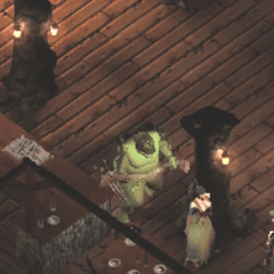

# Fitting a free (CC0/CC-BY) model to a vanilla ToEE skeleton

PoC: a **yuan-ti** (snake-headed humanoid) made from a free CC0 model. It uses the vanilla
`Lizardman_Large` skeleton and **all of its vanilla animations** (the SKA is not changed), and replaces
the Lizard Man (proto 14086, mesh 1016) through a `zz*.dat` override.



## Source model / license
- **"Aedan" snakeman** by Djsedj, **CC0**: https://opengameart.org/content/aedan-blend
  (zip `Yawa_v2019-11-25_0.zip`, mesh `YawaFull`, rig `AedanArmature`, texture `YawaDIFF.png`).
- The source model is **not committed**. Download it from the URL above.
- Also tested (not committed): Quaternius Yeti https://poly.pizza/m/ceRHrn8HHE (CC0) on the Troll rig,
  and Quaternius Giant https://poly.pizza/m/BldaiPtyJa (CC0) on the Troll/Hill Giant rigs.

## Tool: `tools/fit_free_model.py`
```
blender -b --factory-startup --python tools/fit_free_model.py -- \
  --addon <this repo> --target <vanilla>.SKA --source model.(glb|gltf|fbx|blend) [--mesh-object NAME] \
  --map tools/fit_maps/<map>.json --out <dir> --mdf art/meshes/.../name.mdf \
  [--decimate 6000] [--tex-size 512] [--tint r,g,b --tint-amount 0..1]
```
Steps:
1. Import the vanilla SKA rig with this add-on. Import or append the source.
2. Scale the source to the target height.
3. Per-segment fit: each source bone segment listed in the map gets an affine remap onto its ToEE bone
   segment (minimal rotation, then a stretch along the bone axis; limb thickness is kept). Vertices
   follow their dominant source bone.
4. Rename weights through the map. A list value splits one source group over several ToEE bones by
   distance to each bone's segment (e.g. `Leg02 -> [Calf, HorseLink]` for digitigrade legs). Keep the
   top 6 influences.
5. Triangulate and decimate. Convert the texture to TGA, or bake flat material colours to a palette TGA.
   Apply the optional tint.
6. Export only `<target>.SKM`, `<name>.mdf` and `<name>.tga`. The vanilla SKA is reused.

Maps (`tools/fit_maps/*.json`): source bone -> ToEE bone (string, list or `{"follow": seg}`), wildcards allowed.

## Yuan-ti run
```
--target Lizardman_Large.SKA --source Yawa_v2019-11-25.blend --mesh-object YawaFull \
--map tools/fit_maps/aedan_snakeman_to_lizardman.json --decimate 6000 --tex-size 512 \
--mdf art/meshes/Monsters/Lizardman/Lizardman_Large/yuanti.mdf --tint 0.45,0.85,0.35 --tint-amount 0.75
```
Pack `Lizardman_Large.SKM`, `yuanti.mdf` and `yuanti.tga` into `art/meshes/Monsters/Lizardman/Lizardman_Large/` in a zz dat.
In-game check: `SKAVIEW_PROTO=14086 SKAVIEW_ART=art/meshes/Monsters/Lizardman/Lizardman_Large REC_FPS=20 tools/debug/ingame/run-skaview.sh yuanti <packdir>`.

## Known issues
- Decimating 233k to 6k tris gives a lumpy silhouette. Some crumpling at the shoulders/hips in attack frames.
- The tail bones are unused (the model has no tail). The digitigrade legs bend the plantigrade source legs.
- The original texture is pink/red. A green tint was applied for the yuan-ti look.
- The hill giant (protos 14217/14235), even the vanilla one, was not visible at the test spawn spot.
  The cause was not investigated, so the giant tests used the Troll rig.
